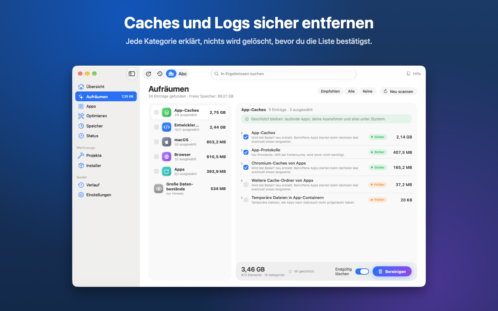
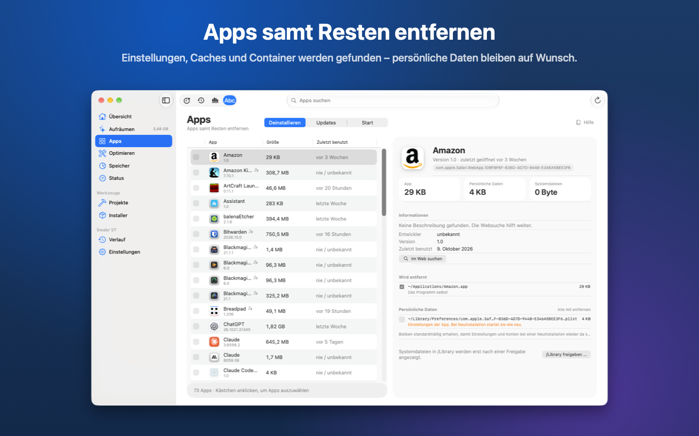
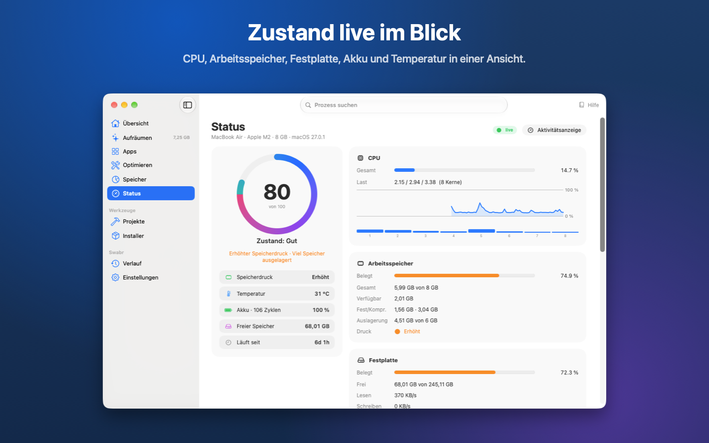
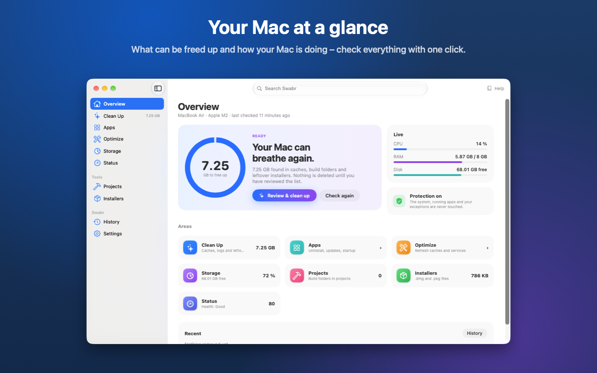
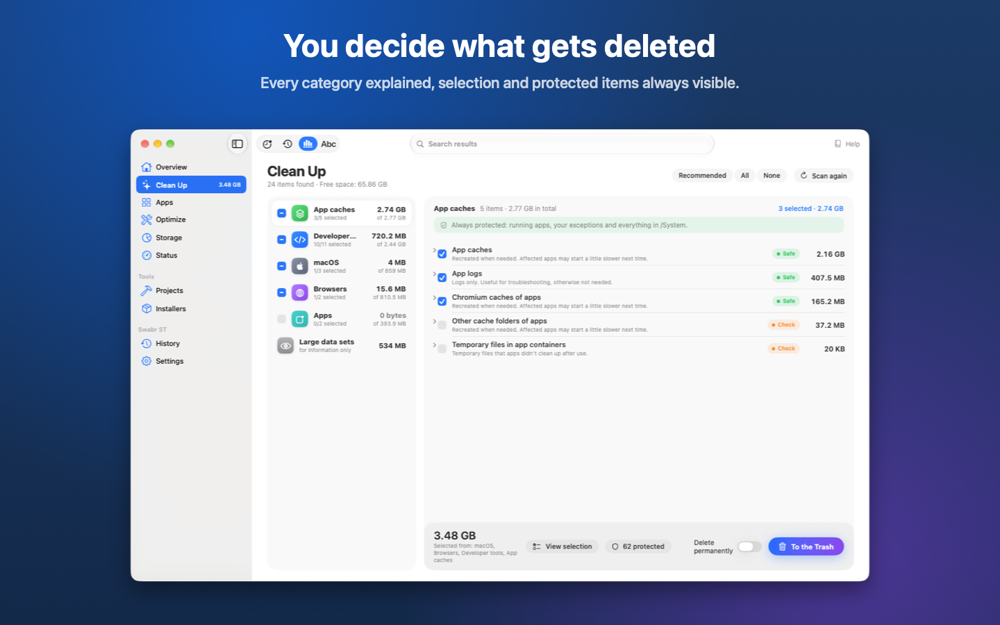
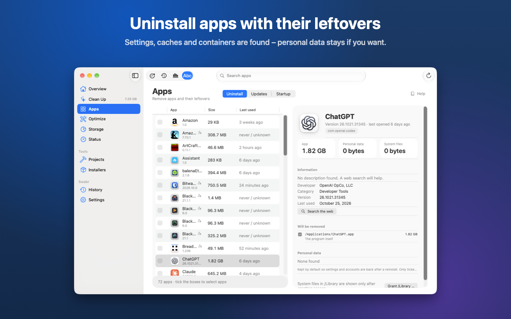
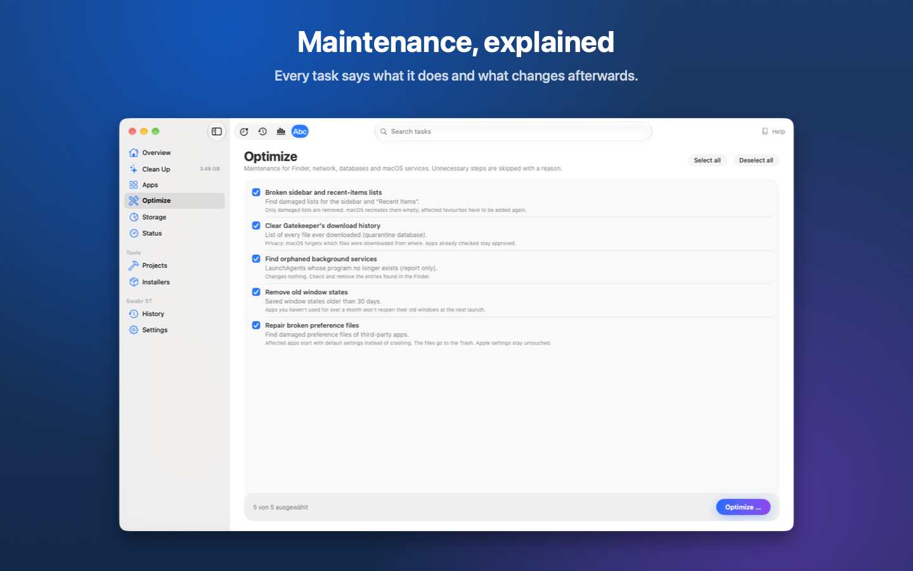
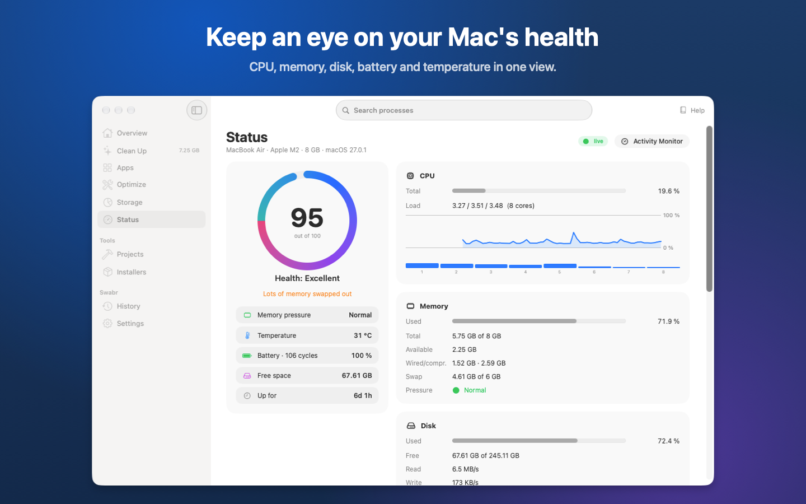

# Swabr

**Swabr** – hält das Deck deines Macs sauber. Native macOS-App (SwiftUI, macOS 27) zum Aufräumen, Deinstallieren,
Speicher analysieren, Optimieren und Überwachen. Kostenlos, in zwei Varianten: Vollversion über GitHub,
eingeschränkte Sandbox-Version im Mac App Store.

**Download:** [Neueste Version (Swabr OP, DMG)](https://github.com/mkmaps/swabr/releases/latest)

## Bildschirmfotos
### Deutsch
| | |
|---|---|
|  |  |
|  |  |
|  | |

### English
| | |
|---|---|
|  |  |
|  |  |
|  | |

## Lizenz
**MIT** (siehe `LICENSE`), © 2026 mkmaps. Der gesamte Code ist eigenständig entwickelt. Der
Lizenzhinweis steht in der App unter Über → Lizenzhinweise.

## Datenschutz und Support
- Datenschutzerklärung: [`PRIVACY.md`](PRIVACY.md) (Swabr erfasst keine Daten).
- Fragen und Fehler: [`SUPPORT.md`](SUPPORT.md).
- Quellcode und Direct-Version: https://github.com/mkmaps/swabr

## Aufräumregeln
- Verbindliches Regelwerk mit Schutzschichten, Abgleich zum Code-Stand und offenen Maßnahmen: `REGELWERK.md`.
- Quelle: `Tools/rules/make_rules.py` → `clean_rules.json`, `Tools/rules/make_protection.py` → `protection.json`
  (`python3 -I Tools/rules/make_rules.py`). Grundlage sind die Ordnerkonventionen von macOS, das Cache-Layout von
  Chromium/Firefox und die dokumentierten Cache-Orte der Werkzeuge, abgeglichen mit einer Bestandsaufnahme.
- Jede Regel hat `section`, `label`, `kind` (bestimmt Erklärung und Standard-Einstufung), optional `safety`,
  `exclude`, `skipIfRunning`, `skipRunningOwner` (pro Treffer die zugehörige App prüfen) und `chromiumOnly`.
- Reihenfolge zählt: Der erste Treffer gewinnt, auch wenn die Regel wegen einer laufenden App übersprungen wird.
  Gezielte Regeln stehen vor den allgemeinen. Tests in `ImpactTests.swift` prüfen Format und Tabu-Bereiche.

## Varianten
| Target | Kennung | Verteilung | Module |
|---|---|---|---|
| `SwabrDirect` (Flag `SWABR_DIRECT`) | `io.github.mkmaps.swabr` | DMG, Developer ID, ohne Sandbox | alle |
| `SwabrStore` (Flag `SWABR_STORE`) | `io.github.mkmaps.swabr.store` | Mac App Store, Sandbox | Aufräumen und Deinstallieren (nach Ordnerfreigabe, /Library optional), Speicher, Status + Menüleiste, Projekte, Installer, Verlauf. Optimieren nur sandbox-taugliche Aufgaben, Updates nur als Hinweis (öffnet App Store/Herstellerseite), Start nur eigene LaunchAgents entfernen, Online-Infos standardmäßig aus. Nicht: Verschlanken |

Welche Module eine Variante zeigt, steht in `App/Shared/Edition.swift` (`Module.inStoreEdition`).

## Bauen
```bash
xcodegen generate          # erzeugt Swabr.xcodeproj aus project.yml
open Swabr.xcodeproj    # Schema SwabrDirect oder SwabrStore
cd Packages/SwabrCore && swift test
swift Tools/make_icon.swift Resources/Assets.xcassets/AppIcon.appiconset   # App-Icon neu zeichnen
```

## Release
```bash
Tools/release.sh direct    # Release-Build, Notarisierung (falls möglich), dist/Swabr-<Version>.dmg
Tools/release.sh store     # Archiv für App Store Connect
```
Für Notarisierung: Zertifikat „Developer ID Application“ und einmalig
`xcrun notarytool store-credentials swabr-notary --apple-id <Mail> --team-id Y94QZAZZ45`.
Die App braucht **Festplattenvollzugriff** (Systemeinstellungen → Datenschutz & Sicherheit).
Ohne Developer-Team ändert sich die Signatur bei jedem Build, dann muss der Zugriff neu erteilt werden.
Daher in Xcode unter *Signing & Capabilities* ein Team eintragen.

## Sprachen und Hilfe
- Oberfläche und Hilfe in 12 Sprachen: Deutsch (Quelle), Englisch, Französisch, Spanisch, Italienisch, Portugiesisch,
  Tschechisch, Slowakisch, Ungarisch, Rumänisch, Kroatisch, Griechisch. Auswahl unter Einstellungen → Allgemein → Sprache.
- String-Kataloge: `Resources/Localizable.xcstrings` (App) und
  `Packages/SwabrCore/Sources/SwabrCore/Resources/Localizable.xcstrings` (Kern), erzeugt mit
  `python3 -I Tools/i18n/build_catalogs.py` aus:
  - `en.json` (Englisch, von Hand; Quelle für alle Übersetzungen),
  - `deepl/<sprache>.json` (fr/es/it/pt-PT, DeepL mit Glossar und Kontext) plus `deepl/overrides.json`
    (Korrekturen aus dem Gegenlesen, gewinnen immer),
  - `manual/<sprache>_1/_2.json` (cs/sk/hu/ro/hr/el, von Hand),
  - `extra.json`/`extra_core.json` (später hinzugekommene Texte).
  Der Bau bricht ab, wenn ein Platzhalter (`%@`, `%lld` …) fehlt oder ein einzelnes `%` übrig bleibt.
- DeepL: `python3 -I Tools/i18n/deepl.py ui|help|glossary <sprache>`, Schlüssel in `~/.config/deepl/key`.
  Glossare in `Tools/i18n/glossary/` legen die App-Begriffe fest (Hilfe und Oberfläche sind wortgleich).
- Hilfe: `Resources/Help/<sprache>/<thema>.md` (19 Themen), Fallback Englisch.
- Regelnamen sind Produktnamen (unübersetzt) oder deutsche Schlüssel aus dem Kern-Katalog (übersetzt).

## Aufbau
- `Packages/SwabrCore`: Logik ohne UI (Regeln, Glob, Größen, Whitelist, Sicherheitsprüfung, Löschen, Protokoll)
- `App/`: SwiftUI-Oberfläche
- `Tools/`: Regel-Generatoren (`rules/`), Übersetzungen (`i18n/`), Icon und Release-Skript

## Sicherheit
- Scan ändert nichts; gelöscht wird erst nach Prüfung und Bestätigung
- Nur Pfade im Benutzerordner, keine Symlinks im Pfad, feste Tabu-Bereiche (iCloud, Keychains, Dokumente …)
- Whitelist `~/.config/swabr/whitelist` (ersetzt Standardwerte, Sicherheitsmuster gelten immer)
- Prüfung wird direkt vor jedem Löschen wiederholt
- Protokoll: `~/Library/Application Support/Swabr/operations.log`

## Fahrplan
| Phase | Modul | Stand |
|---|---|---|
| 1 | Aufräumen: Benutzer-, App-, Browser-, Dev-Caches | ✅ eigene Regeln (123, davon allgemeine Muster; Siri-Vorschläge und IdentityCaches bewusst nicht) |
| 2 | Speicher: Übersicht + Insights, Explorer, Treemap, größte Dateien, Quick Look, Papierkorb | ✅ (ohne APFS-Klon-Erkennung, ohne Cache auf Platte) |
| 3 | Apps: Deinstallieren: App + Caches + LaunchAgents, persönliche Daten optional, Papierkorb | ✅ |
| 3b | Apps: Updates (Homebrew, App Store, Sparkle, Homebrew-Katalog) und Start (LaunchAgents blockieren/erlauben/entfernen) | ✅ |
| 4 | Status: Gesundheitswert, CPU, RAM, Disk-I/O, Netz, Prozesse, Akku, Verlaufskurven | ✅ (ohne CPU-Temperatur, Lüfter, GPU) |
| 5 | Optimieren: 18 Wartungsaufgaben (5 davon in der Store-Variante), Admin-Schritte mit einer Passwortabfrage | ✅ |
| 6 | Projekte und Installer | ✅ |
| 6b | Verschlanken: Intel-Code entfernen, an einer Kopie geprüft | ✅ |
| 7 | Verlauf, App-Icon, Release-Skript, DMG, Hell/Dunkel, Varianten Direct/Store | ✅ (Notarisierung wartet auf Developer-ID-Zertifikat) |
| 1b | Aufräumen: dynamische Regeln (npm/bun/uv/Corepack/Rustup), Reste entfernter Apps, große Datenbestände als Hinweis | ✅ |
| 3c | Deinstallieren: Systemdateien in /Library (Passwort), Homebrew-Casks über brew | ✅ |
| 8 | Paket 1 (Okt. 2026): Speicher „seit gestern gewachsen“, Deinstallieren „Nur Daten löschen“ + Hinweis auf laufende Systemerweiterungen, iPhone/iPad-Apps, eine Passwortabfrage pro Vorgang, Projekte geschützt solange ein Prozess darin läuft, unbenutzte Luftaufnahmen, ältere JetBrains-Versionen, Claude-Code-/Codex-Reste, Simulator-Laufzeiten (Hinweis), App-Store-Region, geglättete Netzwerkraten | ✅ |
| 9 | Paket 2 (offen): ⌘A im Aufräumen, Berechnungsgrundlage beim Speicherwert, Netzteil-Watt, Bedienhilfen (VoiceOver, Kontrast), abgeschnittene Beschriftungen prüfen, ggf. „Bildschirm anlassen“ | offen |
